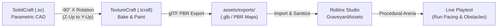

# ArtCraft Suite Asset Creation & PBR Painting: Registered Learnings

*Documenting the end-to-end parametric modeling, texture baking, PBR painting, and Roblox Studio integration pipeline established for `roblouuux`.*

---

## 1. Pipeline Overview

The ArtCraft Suite asset creation pipeline bridges parametric CAD (`solidcraft`), GPU-accelerated PBR texture painting (`texturecraft`), and Roblox Studio runtime integration (`Roblox_Studio`). Across this session, 12 complete assets were modeled, baked, textured, and integrated:
- **3 Combat & Pickup Assets:** `xp_soul_crystal`, `magic_bolt`, `guardian_orb`
- **5 Haunted Graveyard Kit Props:** `grave_cross_headstone`, `grave_arched_tombstone`, `graveyard_iron_fence`, `graveyard_lantern_post`, `graveyard_sarcophagus`
- **3 Ground Clutter Units + 1 Surface:** `ground_grass_tuft`, `ground_dead_roots`, `ground_rubble_cluster`, `surface_cemetery_dirt`

---

## 2. Hard-Won Technical Insights & Rules

### A. SolidCraft CAD Modeling & Polygon Optimization

> [!IMPORTANT]
> **Polygonal Sketches Over Curved Lofts for Game Poly Budgets:**
> In SolidCraft, lofting or revolving circular sketch profiles (`sketch.circle.center`, filleted arcs) generates high-density NURBS tessellations that can exceed 10,000–20,000 triangles for a single small prop.
> 
> For game-ready assets, use polygonal sketches (`sketch.polygon.inscribed`, diamond, hexagonal, or octagonal cross-sections). They reduce polygon counts by **over 90%** (e.g. from 18,000 tris down to 160–340 tris) while maintaining crisp, readable silhouettes from top-down camera views.

- **`solid.box` Origin vs Center:** In SolidCraft's `solid.box` command, always pass `center: [cx, cy, cz]` when positioning bodies relative to an origin. Omitting `corner` without `center` defaults the corner to `[0, 0, 0]`, causing off-center geometry.
- **Body Segmentation Maps to Texture Sets:** Every distinct named body created in SolidCraft (`body_name`) becomes an independent **Texture Set** when imported into TextureCraft. Structuring CAD models into logical material groups (e.g., `StonePlinth`, `IronBars`, `BronzePlaque`, `SoulGemCore`) allows 1-click material assignment during texturing.

### B. Coordinate System Conversion (Z-Up to Y-Up)

> [!WARNING]
> **Coordinate Alignment is Critical for Procedural Texture Generators:**
> - **SolidCraft:** Millimeters (`mm`), **`+Z` is up**, `XY` ground plane.
> - **TextureCraft & Roblox Studio:** Studs / meters, **`+Y` is up**, `-Z` forward.
>
> If an `.obj` is imported into TextureCraft without transformation, upward directional generators (such as `Direction` `[0, 1, 0]` used in `stone_mossy` to place moss on top ledges) will paint sideways across vertical walls!
>
> **The Transformation Formula:**
> Rotate vertices and vertex normals by $-90^\circ$ around $X$:
> $$\begin{pmatrix} x' \\ y' \\ z' \end{pmatrix} = \begin{pmatrix} x \\ z \\ -y \end{pmatrix}$$
> This preserves triangle face winding (determinant $+1$) and aligns the model upright on the ground plane.

### C. TextureCraft Baking & Smart Material Stacks

> [!TIP]
> **Mesh Map Baking Is Mandatory for Smart Materials:**
> Built-in smart materials (`stone_mossy`, `iron_rusted`, `bronze_statue`, `wood_weathered`, `copper_patina`) rely on baked curvature, ambient occlusion, thickness, and position maps. Applying smart materials before running `bake` results in flat, uniform base colors without edge wear or crevices.
>
> Always run `bake {"ts": "all", "resolution": 1024}` immediately following `mesh_import`.

- **Native MCP Calls Over Shell Pipes:** Interacting with `texturecraft-cli mcp` via external scripts can deadlock on standard I/O buffering if `stdin.flush()` is omitted. Always communicate through the native `call_mcp_tool` interface with `ServerName: "texturecraft"`.
- **Path-Traced Previews:** Using `viewport_render` with `samples: 128` (or `texturecraft-cli render ... --samples 128`) produces physically grounded path-traced renders with specular roughness, metal reflection, and normal bump displacement, providing full confidence before in-game importing.
- **Seamless Tileable PBR Surfaces:** To produce tileable environment textures (e.g. `surface_cemetery_dirt`), project smart materials onto a unit quad and export using the preset `"Document channels + Normal + AO"` to output clean 1024x1024 or 2048x2048 normal, roughness, metallic, and base color maps.

### D. Roblox Studio Runtime & Procedural Assembly

- **Dual Deployment Architecture (Local Prefabs + Cloud Meshes):**
  When external mesh asset IDs are uploading or pending moderation, assembling 1:1 multi-part procedural prefabs in `ServerStorage.GraveyardAssets` that match the SolidCraft body hierarchy and TextureCraft color/material palette allows immediate playtesting without blocking gameplay development.
- **BulkMoveTo Optimization Contract (`PERF-1` / `PERF-4`):**
  Client-rendered animated parts must strictly enforce:
  `Anchored = true`, `CanCollide = false`, `CanTouch = false`, `CanQuery = false`.
  This allows hundreds of entity parts to be repositioned in a single `workspace:BulkMoveTo` call at sub-2ms frame budgets.
- **Server-Side Obstacle Sliding for Plain-Table Entities:**
  Because enemies and projectiles have no server instances, solid obstacle collisions are calculated in 2D. Using an oriented bounding box (OBB) circle-cast with tangential wall-sliding ($85\%$ step speed along the longer obstacle axis) prevents enemies from sticking to fence corners or walking through crypt monuments.

---

## 3. Asset Library Registry

| Category | Asset | Source Files | Triangle Count | Key Materials / Visual Notes |
| --- | --- | --- | --- | --- |
| **Combat** | `xp_soul_crystal` | `.sc`, `.tcraft`, `.glb` | 140 | Dual-pyramid faceted crystal, bronze runic collar, tiered inner soul glow (Emerald / Sapphire / Amethyst). |
| **Combat** | `magic_bolt` | `.sc`, `.tcraft`, `.glb` | 76 | Arcane spearhead crystal core, crossed cyan blades, stabilizer fins, trail emitter. |
| **Combat** | `guardian_orb` | `.sc`, `.tcraft`, `.glb` | 196 | Solar neon core, tumbling bronze equatorial & meridian gimbal rings, gold cardinal spikes. |
| **Graveyard** | `grave_cross_headstone` | `.sc`, `.tcraft`, `.glb` | 160 | Weathered slate cross, stepped mossy plinth, engraved bronze epitaph plaque. |
| **Graveyard** | `grave_arched_tombstone` | `.sc`, `.tcraft`, `.glb` | 710 | Arched slate tablet, stepped plinth, glowing cyan runic cross medallion. |
| **Graveyard** | `graveyard_iron_fence` | `.sc`, `.tcraft`, `.glb` | 500 | Wrought-iron fence panel, stone end pillars, horizontal rails, forged spear finials. |
| **Graveyard** | `graveyard_lantern_post` | `.sc`, `.tcraft`, `.glb` | 172 | Forged iron lantern post on stone pedestal, warm amber PointLight flame. |
| **Graveyard** | `graveyard_sarcophagus` | `.sc`, `.tcraft`, `.glb` | 176 | Cursed crypt sarcophagus, ajar lid, relief cross, necrotic violet interior seam. |
| **Clutter** | `ground_grass_tuft` | `.sc`, `.tcraft`, `.glb` | 340 | Overgrown dark cemetery grass tufts with frosted tips. |
| **Clutter** | `ground_dead_roots` | `.sc`, `.tcraft`, `.glb` | 1,414 | Gnarled dark wood creeping roots clustering around monument bases. |
| **Clutter** | `ground_rubble_cluster` | `.sc`, `.tcraft`, `.glb` | 8,376 | Broken tombstone slate shards and mossy cobblestone rubble clusters. |
| **Surface** | `surface_cemetery_dirt` | `.tcraft`, PBR maps | 2 | 1024x1024 tileable cemetery dirt/mud surface texture set. |
| **In-Engine** | `Graveyard_DeadTree` | Procedural prefab | 5 parts | Gnarled dark wood trunk with bare sprawling skeletal boughs. |
| **In-Engine** | `Graveyard_Obelisk` | Procedural prefab | 5 parts | Tapered four-sided slate spire with glowing cyan runic channel. |

---

## 4. Google Drive Documentation Synced

All core design, architecture, and asset tracking documents in Google Drive have been updated to reflect the pure Haunted Graveyard scenario and ArtCraft pipeline:

1. **[Game Design Document](https://docs.google.com/document/d/1t4UT6mSyfz6qAPvWlYSy35f5fBKYhYgThuwF2ZXLSxw/edit):** Updated for Haunted Graveyard theme, starting Guardian Orb loadout, 18 upgrades + Second Wind, all 5 enemy types, level-up pause system, and procedural arena zoning.
2. **[Architecture Overview](https://docs.google.com/document/d/1zgqYcAnbpbyfMgX4ZkcR_DXLOCMeIpeME9VniQd-840/edit):** Documented the server loop with `GameClock` synchronization, `Arena.rebuild()` per-run layout generation, `Arena.resolveObstacle` 2D wall-sliding, `PlayerState.checkMovement` anti-cheat, and client multi-part rendering.
3. **[Asset Pipeline and Credits](https://docs.google.com/document/d/1tyr7FuwpmlfVOzf9sxL2mbJethCRdmewVh7PB5DX4iQ/edit):** Complete catalog of all 12 SolidCraft & TextureCraft assets, removal of legacy `NaturePack`, and credits for all 5 enemy templates.
4. **[Roadmap and Known Limits](https://docs.google.com/document/d/1-D_cKYKGglsIo9gRkGjbgXm5eDlwwJYjExvuWGbVWxw/edit):** Moved movement anti-cheat, level-up freeze, 5 enemy types, and custom 3D asset suite to Completed.
