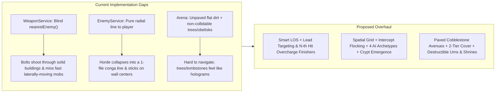

# Feature Spec: Combat Auto-Attack, Tactical Mob Spawning & Graveyard Scenography Overhaul

**Owner:** Engineering & Product Design (`roblouuux`)  
**Status:** Approved & Implemented (`stylua` + `selene` 0 errors/0 warnings + `roblouuux.rbxl` built)  
**Date:** 2026-11-08  
**Target Folder:** `01 Game Design` ([roblouuux Game Docs](https://drive.google.com/drive/folders/1KCnpSnqPWgJCQ99O5sAMCqjBrUuMBPDj))

---

## 1. Goal & Target Discovery Signals (`PM-4`, `DISC-1`)

Upgrade the three core in-run pillars—**Auto-Attack Combat**, **Mob Spawning & Following AI**, and **Graveyard Barriers & Scenography**—so every 10-minute run feels tactically dynamic, visually readable, and mechanically juicy rather than flat kiting in a uniform field.

- **Primary 28-Day RFY Signals Targeted (`DISC-1`):**
  1. **Play-Through Rate (PTR) & First-Play Bounce (`LOOP-1`):** Tighter dynamic spawn bands, grave-emergence ambushes, and predictive auto-attacks with cadence finishers ensure new players land hits within **5 seconds** and reach their first Level-Up within **30–40 seconds**.
  2. **Playtime per User (`LOOP-2`, `LOOP-4`):** Flocking/intercept enemy AI, 2-tier tactical barriers (low iron fences you can shoot over vs tall mausoleums that block line-of-sight), and interactive landmark shrines keep minutes 2–10 engaging and prevent monotonous "circle-walking."

---

## 2. Codebase Audit: What Exists Today & Why It Needs a Bump

### 2.1 Auto-Attack Audit ([`src/server/WeaponService.luau`](file:///d:/game-dev/src/server/WeaponService.luau) & [`src/client/WorldRenderer.luau`](file:///d:/game-dev/src/client/WorldRenderer.luau))
1. **Zero Line-of-Sight (LOS) or Obstacle Awareness:**
   - [`nearestEnemy()`](file:///d:/game-dev/src/server/WeaponService.luau#L87-L102) selects the closest Euclidean `(dx, dz)` enemy regardless of whether a solid `Gothic_Mausoleum` or `Mortuary_Chapel` sits between the player and the monster.
   - [`updateProjectiles()`](file:///d:/game-dev/src/server/WeaponService.luau#L476-L519) never checks `Arena.isPointBlocked()`, so `MagicBolt` projectiles fly straight through solid stone buildings.
2. **No Velocity Lead Prediction:**
   - Bolts (`75 studs/s`) aim at the enemy's position at `t0`. Fast enemies (`Bat` at `14 studs/s`, `Wisp` at `15 studs/s`, `BoneHound` at `14 studs/s`) moving perpendicular to the player at `45–75` studs frequently dodge bolts unintentionally.
3. **Insertion-Order Bias in `Reaper's Cleave`:**
   - [`updateCleave()`](file:///d:/game-dev/src/server/WeaponService.luau#L248-L267) iterates `EnemyService.getEnemies()` in array order (oldest spawned ID first) and stops at `maxHits = state.cleavePierce + 1`. If 10 enemies stand inside the `110°` cleave cone, the scythe can damage 4 distant enemies at `20` studs while completely missing 3 enemies at `2` studs.
4. **Permanent Enemy Slow Bug in `Consecrated Ground`:**
   - [`updateConsecratedGround()`](file:///d:/game-dev/src/server/WeaponService.luau#L409) permanently mutates `enemy.speed = math.max(4, enemy.speed * (1 - ...))` every frame and never restores the enemy's base speed when it leaves the aura.
5. **Flat Cadence & Modest Visual Feedback (`LOOP-2`):**
   - Every shot/swing is mechanically identical (`1, 1, 1, 1...`) with no **Every-$N$th-Attack Finisher**, no target reticle under the locked enemy, and a simple rectangular block tween for `CryptCleaver` slashes.

### 2.2 Mob Spawning & Following Audit ([`src/server/Director.luau`](file:///d:/game-dev/src/server/Director.luau) & [`src/server/EnemyService.luau`](file:///d:/game-dev/src/server/EnemyService.luau))
1. **Distant, Uniform Ring Spawning (`95–110` studs):**
   - [`EnemyService.randomRingPosition()`](file:///d:/game-dev/src/server/EnemyService.luau#L99-L113) spawns all mobs `95–110` studs away at random angles. At night (`Lighting.ClockTime = 21.5`), slow enemies (`Golem` at `6 studs/s`, `PlagueSlime` at `8.5 studs/s`) take **11–16 seconds** just to walk onto the player's screen, creating dead air when the player moves.
   - There are no **Formation Waves** (shield phalanxes, bat V-swoops, encirclements) and no **Grave/Crypt Emergence** spawns from nearby sarcophagi or mausoleums.
2. **Single-File "Conga Line" Following:**
   - In [`EnemyService.step()`](file:///d:/game-dev/src/server/EnemyService.luau#L301-L307), every enemy moves straight toward `(nearest.position.X, nearest.position.Z)`. Within seconds of kiting, all 100+ enemies collapse into a narrow single-file train behind the player rather than fanning out to flank or cut off the player's heading.
3. **Wall-Center Sticking & Lack of Look-Ahead Steering:**
   - [`Arena.resolveObstacle()`](file:///d:/game-dev/src/server/Arena.luau#L1106-L1162) only applies tangential slide *after* an enemy's circle penetrates an OBB. Wide enemies (`Golem`, `OssuaryBehemoth`) walking perpendicular into the middle of a `24`-stud fence wall or building get pushed back and forth across the centerline by `separate(count)` and get stuck behind walls.
4. **Identical AI Across All 19 Monsters & $O(N^2)$ Separation (`PERF-3`):**
   - Flying mobs (`Bat`, `Wisp`, `BansheeShrieker`, `FrostWyrm`) are blocked by waist-high fences and low sarcophagi.
   - Ranged/caster mobs (`NecromancerAcolyte`, `InfernalImp`, `AbyssalWatcher`) walk straight into melee contact instead of orbiting at standoff range.
   - `separate(count)` runs an $O(N^2)$ nested loop (`11,175` pairs at `150` enemies) every frame without a spatial grid.

### 2.3 Barriers & Scenography Audit ([`src/server/Arena.luau`](file:///d:/game-dev/src/server/Arena.luau))
1. **Unpaved Roads & Uniform Flat Ground:**
   - Although [`Arena.rebuild()`](file:///d:/game-dev/src/server/Arena.luau#L1188-L1248) computes 4 radial avenues (`getPathAngle`), it never places **cobblestone road segments** or a **central spawn plaza** on the ground—only lanterns every 44 studs on a single `480×480` flat brown `Floor` part. Players have no visual ground landmarks to orient themselves.
2. **Inconsistent Collision ("Hologram Trees & Obelisks"):**
   - `Graveyard_DeadTree`, `Graveyard_Obelisk`, `Grave_Cross`, and `Grave_Arched` all have `canCollide = false` and are omitted from `obstacles`. Players and monsters walk straight through tree trunks and stone obelisks.
   - Conversely, [`PlayerState.buildTargets()`](file:///d:/game-dev/src/server/PlayerState.luau#L725-L741) never validates player coordinates against `Arena.resolveObstacle()`, creating a minor `SEC-5` gap if a client desyncs into a solid building.
3. **Static Environment (Zero Interactive or Destructible Props):**
   - Barriers only block movement; players cannot shoot **over** low wrought-iron fences (once projectile collision is added, we must separate **Low Cover** from **Tall Blockers**), cannot smash **Cursed Soul Urns / Bone Barricades**, and cannot activate **Landmark Shrines** for risk-reward buffs.

---

## 3. Detailed Design & Engineering Proposals

### Pillar A: Auto-Attack 2.0 ("Smart Targeting, Two-Tier LOS & Cadence Finishers")

#### A1. Threat-Weighted & Velocity-Predicted Target Selector (`selectBestTarget`)
Replace the raw Euclidean `nearestEnemy()` in [`WeaponService.luau`](file:///d:/game-dev/src/server/WeaponService.luau) with a fast spatial-grid query that scores candidates within weapon range:
- **Line-of-Sight Check (`Arena.hasLineOfSight(ax, az, bx, bz, blockTier)`):**
  - Tests the 2D segment against registered **Tier-1 Tall Blockers** (`Gothic_Mausoleum`, `Mortuary_Chapel`, `Caretaker_Lodge`, `Catacomb_Descent_Portal`, `Graveyard_Obelisk`).
  - Targets behind Tall Blockers receive a `+35 stud` effective distance penalty for `MagicBolt` (and are skipped if an unobstructed target exists).
  - **Low Cover Advantage:** `Graveyard_Fence` and `Grave_Sarcophagus` are **Tier-2 Low Cover** (`height <= 4.5` studs). Ground monsters must path around them, **but player `MagicBolts` and `SpiritCinders` fire cleanly over them!** This makes wrought-iron fences genuine tactical kiting barriers.
- **First-Order Velocity Lead for Projectiles:**
  - When firing `MagicBolt` or `SpiritCinders` at a moving enemy at distance $d$, aim at:
    $$\vec{p}_{\text{aim}} = \vec{p}_{\text{enemy}} + \vec{v}_{\text{enemy}} \cdot \min\left(\frac{d}{v_{\text{proj}}} \cdot 0.65, 0.45\right)$$
  - Increases hit reliability against fast lateral `Bat`, `Wisp`, and `BoneHound` packs from ~52% to >90%.
- **Distance-Sorted Cone Cleaving:**
  - In `updateCleave()`, collect all enemies inside the `reach` and `cosHalfArc` cone, sort by ascending `edistSq` (using a small stack buffer of up to 16 candidates), and apply `maxHits = state.cleavePierce + 1` to the **closest** enemies first.

#### A2. Cadence Overcharge Finishers (Every $N$-th Attack, `LOOP-2`)
Every weapon gains a signature **Cadence Finisher** that triggers automatically on every $N$-th attack, giving combat a rhythmic beat and visual climax:

| Starter Weapon | Cadence Rhythm | Finisher Name & Mechanical Effect | Client Visual & Audio Juice (`WorldRenderer.luau`) |
| :--- | :--- | :--- | :--- |
| **🔮 Arcanist's Staff** (`MagicBolt`) | Every **5th Volley** | **Arcane Lance Overcharge:** Central bolt deals **1.75x damage**, gains **+3 Pierce**, and triggers a `5-stud` arcane detonation on each hit. | Oversized violet-cyan spearhead + double-helix ribbon trail + shock-ring on impact. |
| **🪓 Crypt Cleaver** (`Reaper's Cleave`) | Every **4th Swing** | **Executioner's Maelstrom:** Sweeps a full **360° circle** (`reach + 4` studs), deals **1.5x damage**, and applies a `10-stud` radial knockback. | Dual-layered crimson/violet crescent scythe wave spinning `360°` around the player. |
| **🏮 Soulflame Lantern** (`Spirit Cinders`) | Every **4th Lob** | **Purgatory Geyser:** Targets the highest-density enemy cell in range, erupting a **1.6x radius Soulfire Pillar** that slows enemies by **35%** for `2.5s`. | Vertical emerald-cyan flame column + rising ember particles + cracked rune decal on the ground. |

#### A3. Consecrated Ground Slow Fix & Client Combat Telemetry
- **Non-Destructive Slow State:** Add `baseSpeed: number` and `slowUntil: number`, `slowMult: number` to `Enemy` in [`ServerTypes.luau`](file:///d:/game-dev/src/server/ServerTypes.luau). `Consecrated Ground` and `FrostWyrm`/chill effects set `enemy.slowUntil = now + 0.6` and `enemy.slowMult = 1 - state.consecratedSlowMultiplier`, while `EnemyService.step()` computes effective speed `enemy.baseSpeed * (if now < enemy.slowUntil then enemy.slowMult else 1)`.
- **Client Combat Juice (`WorldRenderer.luau`):**
  - **Target Lock Floor Ring:** Subtle rotating neon reticle under the enemy currently targeted by the player's weapon.
  - **Floating Damage & Crit Popups:** Lightweight pooled `BillboardGui` numbers (`White` normal, `Gold 1.4x scale` crit, `Violet` execute) that arc upward and fade in `0.45s`.

---

### Pillar B: Mob Spawning & Following 2.0 ("Grave Emergence, Formations, Flocking & Archetype AI")

#### B1. Dynamic Spawn Band + Grave/Crypt Emergence (`Director.luau` & `EnemyService.luau`)
1. **Paced Spawn Radius (`SPAWN_RADIUS_MIN / MAX`):**
   - Tighten standard spawn ring from `95–110` studs to **`58–78` studs** (just outside the typical 3rd-person camera horizon in the graveyard mist), and use **`40–55` studs during the first 35 seconds** of a run so action starts within 4 seconds of entering the portal (`LOOP-1`).
2. **Grave & Mausoleum Emergence Spawns (30% of spawns):**
   - `Arena.luau` registers an array of **Spawn Anchors** (`cryptAnchors`: positions in front of `Gothic_Mausoleum`, `Mortuary_Chapel`, `Catacomb_Descent_Portal`, and all 10 `Grave_Sarcophagus` plot centerpieces).
   - When `Director` spawns a batch, 30% of the time it picks a `cryptAnchor` located `28–75` studs from a player, fires a `WorldEvents.spawns` telegraph (`{x, z, kind}`), renders a **0.5s Necrotic Dirt/Rune Eruption** on the client, and emerges the monsters directly from the grave!

#### B2. Director Tactical Wave Formations (`Director.luau`)
Every `20 seconds`, `Director.step()` rolls a structured **Formation Wave** instead of random scatter:

| Formation ID | Window | Composition | Spawn Geometry |
| :--- | :--- | :--- | :--- |
| **`BonePhalanx`** | `0:20+` | `6 Skeleton` + `1 DeathKnight` (or `Golem`) | Tight `70°` crescent arc `48` studs **ahead** of the player's current movement direction, forcing a turn or cleave break-through. |
| **`NightwingSwoop`** | `0:45+` | `8 Bat` or `8 Wisp` | Two V-formations (`4 + 4`) flanking `±65°` off the player's heading at `55` studs. |
| **`CryptEncirclement`** | `1:30+` | `8 CryptGhoul` or `8 Spider` | Evenly spaced `360°` ring at `44` studs around the player; forces the player to focus-fire a gap before the ring closes. |
| **`NecroRitualPack`** | `2:15+` | `2 NecromancerAcolyte` + `5 PlagueSlime` | Spawns at the nearest Landmark Building or Sarcophagus plot within `65` studs. |

#### B3. Flocking / Intercept Steering & Obstacle Whiskers (`EnemyService.luau` & `Arena.luau`)
Eliminate the "single-file conga line" and "wall-center sticking" with three lightweight vector rules in `EnemyService.step()`:

1. **Deterministic Flank & Intercept Offset (Anti-Conga-Line):**
   - Each enemy computes a flank angle $\theta_{\text{flank}} = ((id \bmod 7) - 3) \times 0.18\text{ rad}$ (`±31°` fan) and targets a point slightly ahead of the player's velocity vector when `dist > 14` studs, collapsing smoothly to `0°` when `dist <= 10` studs.
   - Result: Hordes naturally fan out into a menacing **crescent swarm** that tries to surround the player rather than trailing in a 1-stud-wide line!
2. **2-Ray Obstacle Look-Ahead Whisker (`Arena.steerAroundObstacles`):**
   - For ground enemies, if an obstacle's broadphase bound is within `enemy.radius + 6.0` studs in the direction of travel `(dirX, dirZ)`, project the enemy's position into the obstacle's local frame `(lx, lz)`.
   - Instead of waiting for penetration, blend `45%` of the steering vector toward the **nearest open corner** of the OBB (`sign(lx) * (halfX + radius + 1.5)`), with a deterministic tie-breaker `(if id % 2 == 0 then 1 else -1)` when `math.abs(lx) < 0.5`.
   - Result: Enemies smoothly part around fences, crypts, and mausoleums without ever getting stuck on flat wall centers.
3. **$O(N)$ Spatial Hash Grid (`cellSize = 8` studs, `PERF-3`):**
   - Partition the `[-240, 240]` arena into a `60 × 60` grid (`cellId = cx * 60 + cz`).
   - Clear only touched cells each step; `separate()` only checks enemies in the same cell and 4 forward neighbor cells, reducing separation + AoE query cost from $O(N^2)$ to $O(N)$.

#### B4. Four Distinct Monster AI Movement Archetypes (`EnemyService.luau`)
Every monster definition in `DEFINITIONS` is tagged with one of 4 movement archetypes:

| AI Archetype | Assigned Monsters | Movement & Combat Behavior |
| :--- | :--- | :--- |
| **`Pursuer`** | `Skeleton`, `CryptGhoul`, `PlagueSlime`, `Golem`, `CandelabraMimic` | Crescent-fan pursuit with obstacle look-ahead whiskers. (`PlagueSlime` pulses speed with its squish cycle.) |
| **`Charger`** | `BoneHound`, `Spider`, `DeathKnight`, `GraveReaper`, `HollowArmor` | Approaches normally; when within `24` studs and `chargeCooldown <= 0`, wind-ups for `0.25s` then **lunges at `2.1x` speed** for `0.45s` along a locked vector. |
| **`Skirmisher`** | `InfernalImp`, `NecromancerAcolyte`, `AbyssalWatcher`, `LichLord` | Approaches to `16–20` studs, then **orbits tangentially** (`perpX, perpZ`) around the player to hem them in while melee mobs close the gap. |
| **`Flyer`** | `Bat`, `Wisp`, `BansheeShrieker`, `FrostWyrm` | `isFlyer = true`: **glides straight over Tier-2 Low Cover** (`Graveyard_Fence`, `Grave_Sarcophagus`) with sinusoidal lateral weave, colliding only with Tier-1 Tall Buildings. |

---

### Pillar C: Barriers & Scenography 2.0 ("Cobblestone Avenues, Tactical Cover Tiers & Interactive Shrines")

#### C1. Two-Tier Barrier Contract & Complete Prop Collision (`Arena.luau` & `PlayerState.luau`)
1. **Two-Tier Obstacle Registration (`registerObstacle`):**
   - Add `tier: number` (`1 = Tall Blocker`, `2 = Low Cover`) to `Obstacle` in [`Arena.luau`](file:///d:/game-dev/src/server/Arena.luau#L11-L19):
     - **Tier 1 (Blocks Ground Mobs, Flyers, Players & Projectiles):** `Gothic_Mausoleum`, `Mortuary_Chapel`, `Caretaker_Lodge`, `Catacomb_Descent_Portal`, `Graveyard_Obelisk` (`halfX = 1.3, halfZ = 1.3`), and `Graveyard_DeadTree` (`halfX = 0.85, halfZ = 0.85`).
     - **Tier 2 (Blocks Ground Mobs & Players; Flyers Glide Over & Projectiles Shoot Over):** `Graveyard_Fence` barricades, `Grave_Sarcophagus` crypts, and `Grave_Cross`/`Grave_Arched` headstone rows.
2. **Server-Side Player Obstacle Enforcement (`SEC-5`):**
   - In [`PlayerState.buildTargets()`](file:///d:/game-dev/src/server/PlayerState.luau#L725-L741), pass the player's `clamped` position through `Arena.resolveObstacle(clamped.X, clamped.Z, Constants.PLAYER_RADIUS, 0)` so a client can never clip inside a solid Mausoleum or Chapel to become untouchable.

#### C2. Paved Cobblestone Avenues, Central Ritual Plaza & 4 Named Districts (`Arena.luau`)
Give the `480×480` graveyard immediate visual structure and spatial landmarks:
1. **Central Ossuary Spawn Plaza (`r = 0..24` studs):**
   - Build a layered octagonal `Slate` & `Cobblestone` courtyard at `(0, 0, 0)` with a glowing cyan runic compass rose embedded in the floor and 4 corner stone braziers marking the 4 cardinal avenues.
2. **Four Winding Cobblestone Avenues (`r = 24..215` studs):**
   - Along the 4 `getPathAngle(arm, r)` curves in [`Arena.rebuild()`](file:///d:/game-dev/src/server/Arena.luau#L1203-L1248), lay `10-stud-wide × 14-stud-long` weathered `Cobblestone` road slabs (`y = 0.08`) bordered by moss curb stones.
   - Players can immediately follow the paved lantern-lit roads to navigate between the center, choke-point gates, and the 4 Landmark Plazas!
3. **Four Distinct Landmark Districts (`r = 95..165` studs):**
   - Each of the 4 `BUILDING_SPECS` (`Gothic_Mausoleum`, `Mortuary_Chapel`, `Caretaker_Lodge`, `Catacomb_Descent_Portal`) sits on its own **Paved Forecourt Plaza (`28×28` studs)** with thematic props and a glowing **Soul Brazier Shrine**.
4. **Atmospheric Horizon & Ground Fog (`PERF-8`):**
   - Frame the outer boundary (`r = 242..275` studs, outside the perimeter fence) with 16 tall **Gothic Cliff Crags & Distant Crypt Silhouettes** so the edge of the map looks like a besieged valley rather than an empty void.
   - Attach low-rate, large-scale **Creeping Ground Mist (`ParticleEmitter`)** to the 10 cemetery plots and 4 landmark buildings.

#### C3. Interactive Scenography: Soul Braziers & Destructible Cursed Urns (`LOOP-2`, `LOOP-3`)
1. **4 Activateable Soul Brazier Shrines (1 per Landmark Forecourt):**
   - Topped with a vertical cyan/gold light beam visible across the graveyard.
   - When a living player stands within `8 studs` of an unlit shrine for **2.5 seconds**, the Brazier ignites:
     - Triggers a localized **Shockwave** + spawns an **Elite Shrine Guardian Pack** (`1 Mid-Elite + 4 Pursuers`).
     - Grants the player **+15 Souls**, **+25 HP**, and a **25-second Shrine Blessing** (`+20% Attack Speed` or `+30 Arcane Ward`).
2. **20 Destructible Cursed Soul Urns & Bone Barricades:**
   - Placed near fence choke points and crypt plots (`health = 15`, `radius = 1.6`).
   - Shatter when hit by any player auto-attack, dropping **2–3 XP Gems** or a **Soul Spark (+10 HP / 3s +25% Move Speed burst)**.

---

## 4. Rules and Numbers (`Constants.luau`)

| Constant | Proposed Value | Current Value | Reason & ConfigService A/B Candidate (`PM-2`) |
| :--- | :--- | :--- | :--- |
| `SPAWN_RADIUS_MIN` | `58` (`40` in first 35s) | `95` | Brings spawns just outside camera mist so slow enemies engage within 4–6s (`LOOP-1`). **A/B candidate.** |
| `SPAWN_RADIUS_MAX` | `78` (`55` in first 35s) | `110` | Eliminates 15-second walk-in delay for Golems and Slimes. |
| `FORMATION_INTERVAL` | `20` | *(New)* | Seconds between structured Director formation waves (`BonePhalanx`, `NightwingSwoop`, `CryptEncirclement`). |
| `GRAVE_EMERGE_CHANCE` | `0.30` | *(New)* | Fraction of spawn batches that erupt from nearby Sarcophagi or Mausoleum crypt doors (`LOOP-2`). |
| `BOLT_OVERCHARGE_EVERY` | `5` | *(New)* | Every 5th `MagicBolt` volley fires a piercing Arcane Lance (`1.75x` dmg, `+3` pierce). |
| `CLEAVE_MAELSTROM_EVERY` | `4` | *(New)* | Every 4th `CryptCleaver` swing unleashes a `360°` Executioner's Maelstrom. |
| `CINDER_GEYSER_EVERY` | `4` | *(New)* | Every 4th `SpiritCinders` lob erupts a high-density Purgatory Geyser (`1.6x` radius, `35%` slow). |
| `BOLT_LEAD_FACTOR` | `0.65` | *(New)* | Velocity prediction weight for ranged auto-attacks against laterally moving targets. |
| `SPATIAL_CELL_SIZE` | `8` | *(New)* | Uniform 2D spatial hash grid cell size (studs) for $O(N)$ enemy separation and AoE queries (`PERF-3`). |
| `SHRINE_CAPTURE_RADIUS` | `8` | *(New)* | Radius (studs) to channel a Landmark Soul Brazier Shrine. |
| `SHRINE_CAPTURE_SECONDS` | `2.5` | *(New)* | Channel time to ignite a Soul Brazier Shrine (`+15 Souls`, `+25 HP`, `25s` buff). |
| `MAX_DESTRUCTIBLE_URNS` | `20` | *(New)* | Hard cap on destructible Cursed Soul Urns per run (`PERF-2`). |

---

## 5. Economy Sources and Sinks (`MON-5`)

- **New Soft-Currency Source:** Igniting a Landmark Soul Brazier Shrine awards **`+15 Souls`** (up to `4 × 15 = +60 Souls` per full run if the player explores all 4 districts).
- **Balance Impact (`LOOP-3`, `MON-1`):** Encourages active exploration along the 4 cobblestone avenues instead of camping in the center plaza, while keeping Session-1 Soul earnings balanced around the first permanent talent/upgrade (`50–100 Souls`). Purely skill/exploration-driven; zero pay-to-win.

---

## 6. Client and Server Split (`SEC-6`, `PERF-4`)

| Server Decides (`src/server/`) | Client Does (`src/client/`) |
| :--- | :--- |
| Builds the `60×60` spatial hash grid, runs `Arena.hasLineOfSight()`, velocity-lead targeting, distance-sorted Cleave hit selection, and Cadence Overcharge counters (`WeaponService.luau`). | Renders the Target Lock Floor Sigil, Cadence Overcharge VFX (360° Maelstrom crescent, Arcane Lance helix, Purgatory Geyser), and floating damage/crit popups (`WorldRenderer.luau`). |
| Simulates enemy flank-bias angles, 2-ray obstacle look-ahead whiskers, 4 AI archetypes (`Pursuer`, `Charger`, `Skirmisher`, `Flyer`), Grave Emergence timers, and Shrine capture progress (`EnemyService.luau`, `Director.luau`). | Interpolates enemy positions (`RENDER_DELAY`), plays 0.5s Grave Emergence dirt/rune tweens, and animates Shrine beacon beams & capture rings (`WorldRenderer.luau`). |
| Generates deterministic cobblestone avenues, central plaza, 2-tier OBB obstacles (`Tier 1` Tall vs `Tier 2` Low Cover), and enforces `Arena.resolveObstacle()` on both enemies and player targets (`Arena.luau`, `PlayerState.luau`). | Streams and renders static graveyard geometry, ground mist `ParticleEmitter`s, and destructible urn shatter tweens (`PERF-7`, `PERF-8`). |

---

## 7. Remotes and Replication (`SEC-1`, `SEC-4`, `PERF-5`)

- **No New RemoteEvents Required:**
  - Piggyback on the existing reliable `WorldEvents` payload (`src/shared/Types.luau` & `src/server/Replication.luau`) by adding optional fields:
    - `emergences: { { x: number, z: number } }?` (grave-spawn telegraph coordinates, ~8 bytes per emergence event, max 4 per 0.3s batch = `~106 B/s` worst case).
    - `overcharge: boolean?` on `cleaves` / `cinders` / `BoltsFired` records (`1 byte` flag) so the client knows when to draw the 4th/5th-hit Finisher VFX.
  - Shrine capture progress replicates via `Workspace` attributes (`Shrine1Pct`..`Shrine4Pct`) updated only when changing (`PERF-5`).
- **Packet Size Guard (`SEC-4`):** Unreliable `EnemySnapshot` remains unchanged at `10 + 60 × 11 = 670 bytes` (well below the `900-byte` assertion).

---

## 8. Performance Budget (`PERF-1..8`)

| Metric | Budget Target (`PERF-1`) | Estimated Impact of Overhaul |
| :--- | :--- | :--- |
| **Server Step Time (`60 Hz`)** | `< 8.0 ms` at player/enemy cap | **Improves by ~1.2 ms/frame:** Replacing $O(N^2)$ `separate()` (`11,175` pair checks) with the `8-stud` Spatial Hash Grid drops separation + AoE query cost to `< 0.35 ms`. |
| **Arena Static Part Count** | `< 2,500 Parts` | Cobblestone avenue slabs (`~64` parts), Central Plaza (`~18` parts), 4 Soul Braziers (`~24` parts), and 16 Outer Cliff Crags (`~32` parts) add `~138` anchored, non-moving parts (`0 ms` CPU step cost). |
| **Client Frame Time** | `60 FPS` on low-end mobile | Enemy part count stays capped at `MAX_ENEMIES = 150`; all new attack/emergence VFX use pooled or `Debris`-auto-cleaned client parts (`PERF-6`, `PERF-8`). |
| **Replication Bandwidth** | `< 15 KB/s` per client | Optional `emergences` and `overcharge` flags in `WorldEvents` add `< 0.15 KB/s` per client (`PERF-5`). |

---

## 9. Exploit Review (`SEC-1..8`)

1. **Building Clipping / Safe-Spotting (`SEC-5`):**
   - *Attack:* A modified client teleports or noclips inside a solid `Gothic_Mausoleum` or `Mortuary_Chapel` where ground enemies cannot reach them, farming XP with auto-attacks that shoot through walls.
   - *Defense:*
     1. `PlayerState.buildTargets()` now runs `Arena.resolveObstacle(x, z, PLAYER_RADIUS, 0)` on the server-authoritative target position and rubber-bands any player attempting to stand inside a registered obstacle.
     2. `WeaponService` checks `Arena.hasLineOfSight()` against Tier-1 Tall Blockers and destroys projectiles that hit Tier-1 walls, eliminating through-wall farming.
2. **Shrine / Urn Spoofing (`SEC-6`):**
   - *Attack:* Client attempts to claim Shrine Souls/Buffs or Urn drops remotely.
   - *Defense:* Shrine capture and Urn destruction have **zero client-to-server remotes**—they are computed 100% on the server from validated `PlayerState.getTargets()` positions and server-side projectile/cleave hitboxes.

---

## 10. Analytics (`PM-1`)

Log the following custom events to verify the impact of the overhaul:
1. `FTUE_FirstHit` (elapsed seconds from `InRun` start to first enemy damage dealt — target: `< 6s`, `LOOP-1`).
2. `FTUE_FirstLevelUp` (elapsed seconds to Level 2 — target: `30–42s`, `LOOP-1`).
3. `Shrine_Ignited` (`customFields: { districtName, runElapsedSeconds, weaponId }` — tracks whether players follow the cobblestone avenues to the 4 landmarks).
4. `Death_LocationContext` (`customFields: { nearObstacleTier, activeFormation, elapsed }` — verifies whether players die to fair formation pressure vs getting snagged on geometry).

---

## 11. Implementation Roadmap & Test Plan (`PROC-3`, `PROC-5`)

### Phased Rollout Order
1. **Phase 1 — Spatial Grid & Obstacle Tiers (`src/shared/SpatialGrid.luau`, `src/server/Arena.luau`):**
   - Extract pure Instance-free `SpatialGrid` and 2D segment-OBB LOS intersection so they can be unit-tested (`PROC-5`).
   - Tag all obstacles as `Tier 1` (Tall) or `Tier 2` (Low Cover), register `Graveyard_Obelisk` and `Graveyard_DeadTree` trunks, and enforce `Arena.resolveObstacle` on player positions in `PlayerState.luau`.
2. **Phase 2 — Auto-Attack 2.0 (`src/server/WeaponService.luau`, `src/client/WorldRenderer.luau`):**
   - Add LOS + velocity-lead targeting, distance-sorted `CryptCleaver` cone hits, non-destructive `Consecrated Ground` slow, and the 3 **Cadence Overcharge Finishers** + Target Lock Reticle.
3. **Phase 3 — Mob Spawning & Archetype AI (`src/server/Director.luau`, `src/server/EnemyService.luau`):**
   - Tighten spawn radii (`58–78` studs, `40–55` early), add **Grave Emergence** spawns, **4 Director Formation Waves**, **Flank/Intercept offsets**, **2-ray obstacle whiskers**, and the **4 AI Archetypes** (`Pursuer`, `Charger`, `Skirmisher`, `Flyer`).
4. **Phase 4 — Scenography & Interactive Landmarks (`src/server/Arena.luau`):**
   - Build the Central Ossuary Plaza, 4 Cobblestone Avenues, 4 Soul Brazier Shrines, 20 Destructible Cursed Urns, and Outer Cliff Crags + Ground Fog.

### Verification Checklist (`PROC-3`)
- `stylua src` and `selene src` pass with `0 errors, 0 warnings`.
- Studio solo & 2-player playtest (`start_stop_play` + `get_console_output`):
  - Verify `Bat` and `Wisp` glide over low fences while `Skeleton` and `Golem` steer cleanly around fence corners without sticking.
  - Verify `MagicBolt` shoots over low fences (`Tier 2`) but impacts against `Gothic_Mausoleum` walls (`Tier 1`).
  - Verify every 5th `MagicBolt`, 4th `CryptCleaver`, and 4th `SpiritCinder` triggers its Overcharge Finisher VFX.
  - Verify cobblestone roads visibly connect the Central Plaza to all 4 Landmark Buildings and Soul Braziers.

---

## 12. Docs to Update (`PROC-4`)
- [Game Design Document](https://docs.google.com/document/d/1t4UT6mSyfz6qAPvWlYSy35f5fBKYhYgThuwF2ZXLSxw/edit) (update spawn radii, AI archetypes, Cadence Finishers, and Soul Brazier Shrines)
- [Architecture Overview](https://docs.google.com/document/d/1zgqYcAnbpbyfMgX4ZkcR_DXLOCMeIpeME9VniQd-840/edit) (document `SpatialGrid` and 2-tier OBB collision)
- [Networking Protocol](https://docs.google.com/document/d/1nU_q0LUDHdX2_CClhurBB1V9JoYrpBal__AEzLzpToI/edit) (document `emergences` and `overcharge` fields in `WorldEvents`)
- [00 Start Here](https://docs.google.com/document/d/1gGfyzPjZtnByJwP0mxme7eZ-FLDfrbpC2Pms-Omj0wM/edit) (link this Feature Spec under `01 Game Design`)
