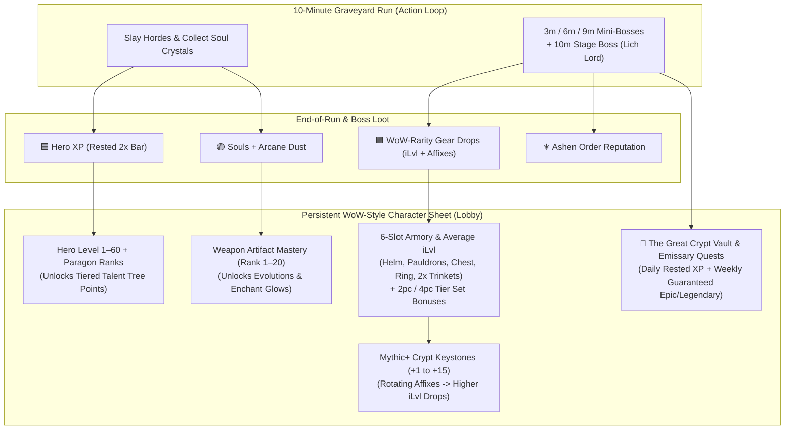
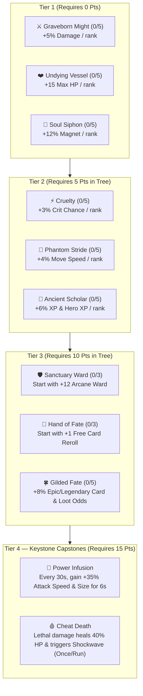

# WoW-Style RPG Progression, Gamification & Monetization Strategy (`roblouuux`)

**Applicable Rules:** `DISC-1..6`, `LOOP-1..6`, `MON-1..6`, `POL-1..2`, `DATA-1..7`, `PM-1..4`, `SEC-1..8`  
**Design Pillar:** *"Vampire Survivors combat speed meets World of Warcraft RPG character progression, loot dopamine, and daily/weekly ritual loops."*

---

## 1. Why "WoW-fying" the Meta-Loop Solves Retention & Monetization

Right now, [`src/client/LevelUpUi.luau`](file:///d:/game-dev/src/client/LevelUpUi.luau) already uses WoW-inspired tooltip cards during a run, but **everything resets to zero when the run ends**. By layering authentic **World of Warcraft RPG progression** onto the Sanctuary Lobby and Boss Kills, every 10-minute run feeds **five persistent character growth bars** that pull players back tomorrow, next week, and across the 28-day Roblox recommendation window (`DISC-1`):

---

## 2. The 6 Core "WoW-fied" Progression Systems

### 2.1 Persistent Hero Level (`1–60`), Talent Points & "Sanctuary Rested XP" (`LOOP-3`, `LOOP-5`)
- **Account Hero Level (`1 → 60` + Paragon Ranks):**
  - Every run awards **Hero XP** based on survival time, kills, and bosses slain.
  - Each Hero Level grants **+1 Persistent Specialization Talent Point** and unlocks new titles/features.
- **🟦 The "Sanctuary Rested Bonus" (Classic WoW Inn Mechanic):**
  - While offline (or at daily reset), resting in the Sanctuary Courtyard fills your **Rested Bar** (up to **150% of a Hero Level**).
  - While **Rested**, your Hero XP bar turns **WoW Royal Blue** and grants **200% Hero XP + +50% Bonus Souls** until the Rested pool is consumed (typically 1.5 to 2 runs).
  - *Why it works:* Gives players an immediate, tangible reason to log in every single day ("My Rested bar is full!").

### 2.2 WoW-Style 6-Slot Armory, Item Level (`iLvl`) & Tier Set Bonuses (`LOOP-2`, `LOOP-4`)
Defeating the `03:00`, `06:00`, `09:00` Mini-Bosses and the `10:00` Stage Boss (*Lich Lord*) drops **Loot Relics** inspected with classic **WoW Color-Coded Tooltips**:
- **Rarity Tiers:**
  - ⬜ **Common** (`iLvl 5–15`, 1 stat)
  - 🟩 **Uncommon** (`iLvl 16–30`, 1 stat + random suffix like *"of the Tiger"*, *"of the Whale"*)
  - 🟦 **Rare** (`iLvl 31–50`, 2 stats + suffix)
  - 🟪 **Epic** (`iLvl 51–75`, 3 stats + **Tier Set piece** or **Unique Trinket Proc**)
  - 🟧 **Legendary** (`iLvl 76–100`, 3 stats + **Game-Changing Passive Effect** in gold/orange flavor text)
- **The 6 Equipment Slots & Average Item Level (`Avg iLvl`) Badge:**
  Displayed on a WoW-style **Character Paperdoll Modal (`[C]` / "🛡️ ARMORY" button)** in the Lobby and above player nametags (`[Lv. 24 • iLvl 48]`):
  1. **Head (`Helm / Cowl`)** — Health, Armor, Cooldown Reduction
  2. **Shoulders (`Pauldrons / Mantle`)** — Weapon Damage, Area Size, Crit Chance
  3. **Chest (`Breastplate / Robes`)** — Max Health, Damage Reduction, Ward Capacity
  4. **Finger (`Signet Ring`)** — XP Gain, Pickup Radius, Luck (`Fortune`)
  5. **Trinket 1 (`Phylactery`)** — *Iconic WoW-style proc!* (e.g., *"Equip: Your crits have a 15% chance to summon a Chain Lightning arc for 35 damage."*)
  6. **Trinket 2 (`Darkmoon Relic`)** — *Iconic WoW-style proc!* (e.g., *"Equip: Taking damage grants Bloodlust (+25% Attack Speed for 4s, 15s CD)."*)
- **Tier Set Bonuses (`2-Piece` & `4-Piece`):**
  - Equipping **2 pieces** or **4 pieces** of a named set (e.g., *Vestments of the Violet Star*, *Battlegear of the Bone Reaper*, *Raiment of the Ashen Pyre*) activates glowing green **`(2) Set:`** and **`(4) Set:`** lines on the tooltip!
- **Disenchanting & Enchanting Forge (No Useless Drops):**
  - Any lower-`iLvl` or duplicate item can be **1-Click Disenchanted** into **✨ Arcane Dust** (greens/blues) or **🔮 Nexus Crystals** (epics), which are spent alongside **Souls** to **Enchant (`+1` to `+10`)** your equipped slots permanently!

### 2.3 Classic 3-Row Tiered Specialization Talent Tree (Sanctuary Soul Altar)
Instead of flat, disconnected shop buttons, the **Sanctuary Soul Altar** is structured like a **classic WoW Specialization Tree** (5 rows deep—spend 5 points in Row 1 to unlock Row 2, culminating in a Row 5 **Keystone Capstone Talent**):

### 2.4 Weapon Artifact Mastery (`Ranks 1–20` per Weapon)
Inspired by *WoW: Legion Artifact Weapons*:
- Playing a run with **🔮 Arcanist's Staff**, **🪓 Crypt Cleaver**, or **🏮 Soulflame Lantern** levels up that weapon's **Artifact Mastery (`Rank 1 → 20`)**.
- Milestone ranks unlock permanent **Artifact Traits & Visual Weapon Skins/Glows**:
  - **Rank 5:** Unlocks **Weapon Enchant Glow** (Neon Cyan / Blood Crimson / Ghostfire Emerald particles on your weapon and projectiles).
  - **Rank 10:** Unlocks a **4th Signature Weapon Talent** in your in-run level-up pool.
  - **Rank 15:** Starts every run with **Rank 1 of your Paired Aura already active**.
  - **Rank 20:** Unlocks the **"Mage Tower" Ascended Weapon Appearance** + Title.

### 2.5 Mythic+ Crypt Keystones (`+1` to `+15`) & Boss Pacing (`LOOP-4`)
- **Normal Graveyard Run (`10:00` Climax):**
  - `03:00`: **Grave Reaper** Mini-Boss (drops 1 Loot Chest)
  - `06:00`: **Hollow Armor** Mini-Boss (drops 1 Loot Chest)
  - `09:00`: **Ossuary Behemoth** Mini-Boss (drops 1 Loot Chest)
  - `10:00`: **The Lich Lord** Stage Boss (Boss HP Bar at top of screen). Defeating him clears the dungeon, awards a **Boss Loot Chest**, and drops a **🗝️ Crypt Keystone (`Mythic +1`)**!
- **Mythic+ Keystone Runs (At the Runic Portal in Lobby):**
  - Before stepping into the Crypt Portal, players can slot their highest **Mythic+ Keystone (`+1` to `+15`)**.
  - Each Keystone level scales enemy HP/Damage, raises the **minimum `iLvl` of all dropped gear**, boosts **Souls earned (`+25%` per Keystone level)**, and adds rotating **WoW Mythic+ Affixes**:
    - **🔥 Volcanic (+2):** Flame plumes periodically erupt beneath distant players.
    - **🩸 Sanguine (+4):** Slain elites leave a pool of ichor that heals foes and damages players.
    - **💀 Bolstering (+7):** Dying enemies empower nearby allies with +15% size and health.
    - **👑 Tyrannical (+10):** Mini-bosses and the Lich Lord gain +40% health and summon elite guards.

### 2.6 Daily Emissary Quests, Faction Reputation & "The Great Crypt Vault" (`LOOP-5`)
1. **⚜️ Faction Reputation (*Order of the Ashen Sanctuary*):**
   - Runs, bosses, and daily bounties award **Reputation** across WoW's iconic brackets:
     **`Neutral (0/3,000) → Friendly (0/6,000) → Honored (0/12,000) → Revered (0/21,000) → Exalted`**
   - Reaching each bracket unlocks exclusive Quartermaster rewards in the Lobby (Titles above your head, Enchant illusions, and at **Exalted**, the *"Ashen Cryptlord"* wings/aura).
2. **📜 3 Daily Emissary Quests:**
   - Complete 3 daily objectives (*Slay 200 Undead*, *Defeat the 3:00 Mini-Boss*, *Survive to Minute 8*) to claim the **Emissary Cache** (`+150 Souls`, `+250 Rep`, `+1 Guaranteed Rare+ Gear Piece`, `+1 Fate Die`).
3. **🏦 The Great Crypt Vault (Weekly Return Hook):**
   - Just like WoW's **Great Vault** every weekly reset:
     - **Slot 1:** Complete **1 Dungeon Run** this week
     - **Slot 2:** Complete **4 Dungeon Runs** this week
     - **Slot 3:** Complete **8 Dungeon Runs** (or a Mythic+ Keystone) this week
   - Each unlocked Vault slot generates a guaranteed high-`iLvl` **🟪 Epic** or **🟧 Legendary** item to choose from!

---

## 3. WoW-Flavored Ethical Monetization Matrix (`MON-1..6`, `POL-1`)

Every product fits naturally into the WoW-style RPG fantasy without selling raw P2W gear:

| Tier | Product Name | Price Target | WoW-Style RPG Value Proposition |
| :--- | :--- | :---: | :--- |
| **Impulse 1 (Built)** | **⚡ Soulstone Revive (Ankh / Battle Rez)** | `29 R$` (or `150 Souls` 1x/run) | Instant Battle Rez at 100% HP, keeps all in-run talents, 3s Divine Shield immunity + 36-stud Holy/Eldritch Nova. Includes **0.8s safety grace delay** (`MON-6`). |
| **Impulse 2 (New)** | **🎲 Bonus Roll Coin (Seal of Wartorn Fate)** | `15 R$` (or `1 Fate Die`) | Rerolls your 3 Level-Up Talent Cards (guaranteed Rare+) OR triggers a **Bonus Loot Roll** on a defeated Boss Chest! |
| **Impulse 3 (New)** | **👑 Miracle Roll ("Claim All 3 Talents")** | `39 R$` | When 3 amazing cards roll on Level-Up, claims all 3 simultaneously (max 2/run). |
| **Server Social (New)** | **🩸 Rallying Cry of the Dragonslayer / Blood Moon Banner** | `99 R$` | Drops a War Banner in the Sanctuary Courtyard for **15 minutes**, buffing **everyone in the server** with **2x Souls, +50% Hero XP, and +15% Move/Attack Speed**, with a server-wide gold raid announcement! |
| **Starter Bundle** | **🎁 Adventurer's Heirloom Chest (One-Time)** | `49 R$` | Grants an **🟨 Heirloom Trinket** (*scales its `iLvl` automatically with your Hero Level!*), **`+500 Souls`**, **`+5 Bonus Roll Coins`**, and a full **Rested XP Bar**. |
| **Game Pass 1** | **🧲 Astral Loot Vacuum (`+50% Magnet`)** | `149 R$` | Permanently boosts Soul Crystal & Loot Chest pickup radius by `+50%`. |
| **Game Pass 2** | **🃏 Archmage's Insight (`+1 Talent Card Slot`)** | `299 R$` | Shows **4 Talent Cards instead of 3** on every in-run level-up + `+1` free Bonus Roll Coin per run. |
| **Game Pass 3** | **🟣 Tabard of the Soul Harvester (`2x Souls & Rep`)** | `399 R$` | Permanently doubles **Souls**, **Arcane Dust** from disenchanting, and **Ashen Order Reputation** gains. |

---

## 4. Phased Implementation Plan (Codebase Execution)

We can build this cleanly into [`src/`](file:///d:/game-dev/src) in **3 structured phases**:

### Phase 1: Persistent Character Profile, Hero Level + Rested XP, 6-Slot WoW Armory & Tiered Talent Tree (`DATA-1`, `LOOP-3`)
1. **[`src/shared/RpgConfig.luau`](file:///d:/game-dev/src/shared):**
   - Define the **Tiered Sanctuary Talent Tree** (Rows 1–4 + Capstones), **6-Slot Gear Generator** (WoW rarity colors, `iLvl` scaling, suffixes, 2pc/4pc Set Bonuses, Trinket procs, Disenchant values), **Hero Level XP curve (`1–60`)**, **Rested XP rules**, and **Ashen Order Reputation brackets**.
2. **[`src/server/DataService.luau`](file:///d:/game-dev/src/server):**
   - Persistent `DataStoreService` profile (`User_{UserId}`, schema `v1`, session-lock safe, auto-save, `BindToClose`, and Studio fallback) storing:
     `souls`, `arcaneDust`, `fateDice`, `heroLevel`, `heroXp`, `restedXp`, `reputation`, `weaponMastery`, `talents`, `equippedGear` (6 slots), `inventoryGear`, `highestKeystone`, `dailyQuests`, `greatVaultProgress`.
3. **[`src/server/PlayerState.luau`](file:///d:/game-dev/src/server/PlayerState.luau) & [`src/client/LobbyAndDeathUi.luau`](file:///d:/game-dev/src/client/LobbyAndDeathUi.luau):**
   - Apply equipped **6-Slot Gear stats + Set Bonuses + Sanctuary Talent Tree** to player stats on run start, display `[Lv. X • iLvl Y • Title]` overhead/HUD badge, award Hero XP (consuming Rested XP), and open the **WoW Character Sheet & Talent Tree UI** in the Sanctuary Lobby + End-of-Run Loot drops!

### Phase 2: Boss Loot Drops (`3m/6m/9m/10m`), Mythic+ Keystones & Great Vault (`LOOP-4`, `LOOP-5`)
1. Promote `GraveReaper` (`3:00`), `HollowArmor` (`6:00`), `OssuaryBehemoth` (`9:00`), and `LichLord` (`10:00`) from [`EnemyCandidates.luau`](file:///d:/game-dev/src/server/EnemyCandidates.luau) into active spawns in [`EnemyService.luau`](file:///d:/game-dev/src/server/EnemyService.luau) & [`Director.luau`](file:///d:/game-dev/src/server/Director.luau).
2. Drop **WoW-Rarity Gear Items** on mini-boss and stage boss kills (with floating WoW loot toast banners!) and unlock **Mythic+ Keystone selection (`+1` to `+15`)** at the Lobby Portal + **Daily Emissary Quests & Great Vault UI**.

### Phase 3: Full WoW-Flavored Monetization Suite & Co-Op Raid Hooks (`MON-1..6`, `LOOP-6`)
1. Expand [`MonetizationService.luau`](file:///d:/game-dev/src/server/MonetizationService.luau) and [`LevelUpUi.luau`](file:///d:/game-dev/src/client/LevelUpUi.luau) with **Bonus Roll Reroll**, **Miracle Roll (Claim All 3)**, **Rallying Cry Server Buff Banner**, **Heirloom Starter Chest**, and the **3 Game Passes** (all testable in Studio).
2. Add the **Co-Op Downed Teammate 3s Battle-Rez Ring** and **+10% Party/Friend XP & Souls Buff**.
