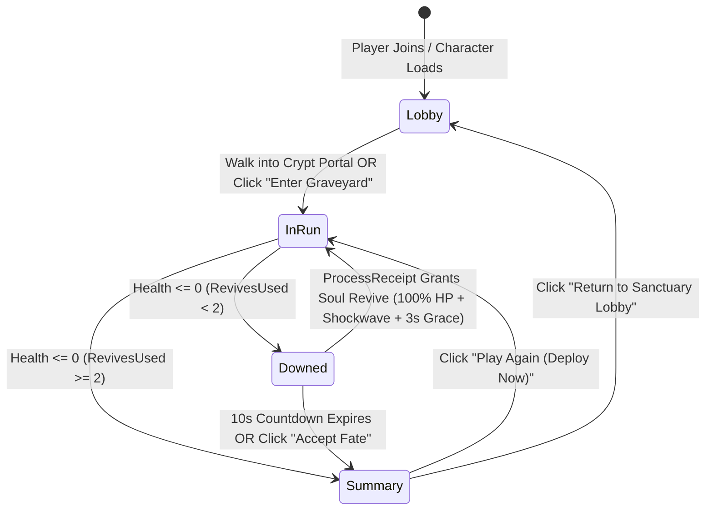
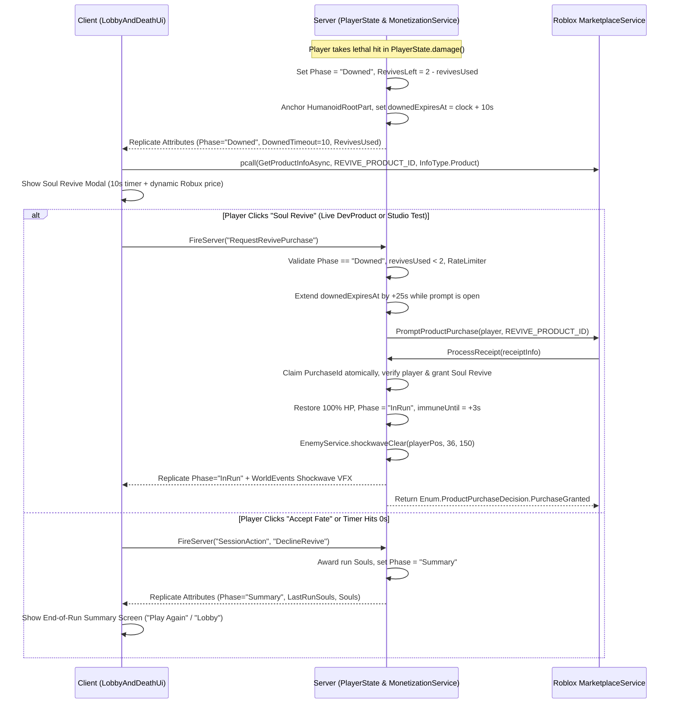

# Feature Spec & Implementation Plan: Haunted Sanctuary Lobby & Monetized Mid-Run Respawn (`PROC-1` / `PROC-2`)

> [!IMPORTANT]
> Per `PROC-1` (Feature Spec) and `PROC-2` (Decision Record for monetization & player lifecycle changes), this plan specifies the client/server architecture, security boundaries, product rules (`LOOP-1..6`, `MON-1..5`, `POL-1`), and exact file changes **before implementation begins**.

---

## 1. Executive Summary & Product Goals

Currently, [init.server.luau](file:///Users/m/roblouuux/src/server/init.server.luau#L27-L34) and [`PlayerState.reset`](file:///Users/m/roblouuux/src/server/PlayerState.luau#L114-L177) drop joining players immediately into `(0, 0.5, 0)` in the active graveyard arena and rely on `Players.RespawnTime = 3` ([Constants.luau](file:///Users/m/roblouuux/src/shared/Constants.luau#L20)) to wipe the player's build 3 seconds after death.

That prototype flow prevents both **pre-run social staging** and **emotional run-salvage monetization**. This feature introduces the complete **Core Loop Wrapper**:

1. **Haunted Sanctuary Courtyard Lobby (`LOOP-1`, `LOOP-6`):**
   - Players spawn in an atmospheric **Sanctuary Mausoleum Courtyard** perched just outside the north Gothic Gate of the graveyard (`Z = -280`, elevated at `Y = 14` overlooking the arena).
   - Features a glowing **Eldritch Crypt Portal** (physical walk-in trigger) **plus** an instant 1-click **"ENTER THE GRAVEYARD" HUD button** so new players can still enter combat and land their first auto-attack within 10 seconds (`LOOP-1` Zero-Friction FTUE).
   - Displays the player's session **Souls** (meta-currency wallet, `LOOP-3`) and Best Run stats.
2. **Monetized Mid-Run Respawn — "Soul Revive" (`MON-1`, `MON-2`, `MON-3`, `POL-1`):**
   - When a player takes lethal damage during a run, instead of killing the `Humanoid` (`humanoid.Health = 0`) and wiping their build, the server transitions the player into the **`"Downed"`** phase for **`REVIVE_WINDOW_SECONDS = 10`**.
   - While downed, the player's character is anchored and invulnerable, and (in solo play or when all living players are downed/choosing) the simulation pauses via [`GameClock.pause()`](file:///Users/m/roblouuux/src/shared/GameClock.luau) so enemies freeze in place around the player.
   - A high-contrast **Soul Revive Offer Modal** appears with a 10-second countdown bar:
     - **Primary CTA — "⚡ SOUL REVIVE (Keep Level & Build + Eldritch Shockwave)":**
       - Restores **100% Max Health**, preserves all **Levels & Upgrades**, grants **3.0s of Invulnerability**, and detonates an **Eldritch Shockwave** (`REVIVE_SHOCKWAVE_RADIUS = 36` studs) that knocks back and deals massive damage to surrounding enemies (`LOOP-2`).
       - Capped at **`MAX_REVIVES_PER_RUN = 2`** (`MON-2`) so skill remains paramount (`MON-1`).
       - Dynamic localized Robux price fetched on the client via `MarketplaceService:GetProductInfoAsync` inside `pcall` (`MON-3`), backed by an atomic server `MarketplaceService.ProcessReceipt` handler (`POL-1`).
       - Includes a **Studio Dev-Test Mode** (and optional **Souls Revive** fallback when `REVIVE_PRODUCT_ID == 0` in Studio) so the full purchase & shockwave flow can be playtested and verified cleanly before a live Developer Product ID is configured.
     - **Secondary CTA — "Accept Fate (End Run)":** Skips the remaining countdown and opens the End-of-Run Summary immediately.
3. **End-of-Run Summary Screen (`LOOP-3` — No Dead Runs):**
   - When a player declines the revive, runs out of time, or uses all `2` revives and dies again, they enter the **`"Summary"`** phase.
   - Displays **Time Survived**, **Enemies Slain**, **Level Reached**, and **Souls Earned** (`floor(kills * 1 + survivedSeconds * 0.25)`), with two 1-click buttons:
     - **"⚔️ Play Again (Deploy Immediately)"** — resets build and drops straight into the arena (`(0, 3, 0)`).
     - **"🏛️ Return to Sanctuary Lobby"** — teleports the player back to the Sanctuary Courtyard with their earned Souls.

---

## 2. Player Lifecycle & State Machine (`PROC-2` Decision Record)

### Why Virtual Health + Explicit Phases Instead of `Humanoid.Health = 0`?
If `humanoid.Health` reaches `0`, Roblox's engine breaks character joints, triggers ragdoll/death state, and forces a character destroy/re-spawn cycle after `Players.RespawnTime`. By keeping `humanoid.Health = 100` on the Roblox `Humanoid` instance and managing health/death strictly inside [`PlayerState`](file:///Users/m/roblouuux/src/server/PlayerState.luau) via a replicated `Phase` attribute (`"Lobby" | "InRun" | "Downed" | "Summary"`):
- Reviving is instantaneous—no character reload, no camera stutter, and no lost upgrades.
- Returning to the Lobby or deploying into a new run is a clean server-side `PivotTo` + state reset.

### Pause & Co-Op Behavior During `"Downed"`
- **Pause Pause-Hold Bound:** While a player has an active `"Downed"` revive offer open (`now < state.downedExpiresAt`) **or** has a purchase prompt actively open (`state.purchasePromptOpen` up to a 30s safety cap), `PlayerState.anyPauseActive()` pauses the shared `GameClock` if no other living `"InRun"` teammate is actively fighting, or anchors the downed player in place with a glowing tombstone beacon in co-op.
- **When Purchase Prompt Opens:** Opening Roblox's native `PromptProductPurchase` modal takes 3–8 seconds for a user to confirm. When the server detects `MarketplaceService.PromptProductPurchaseFinished` (used **only** to detect prompt dismissal/cancellation, **never** to grant items per `POL-1`), if the purchase was cancelled, the remaining countdown resumes smoothly.

---

## 3. Sequence Diagram: Monetized Mid-Run Respawn (`POL-1`, `SEC-1..8`)

---

## 4. Architecture & File-by-File Breakdown

### 4.1 Shared Constants & Types
- **[Constants.luau](file:///Users/m/roblouuux/src/shared/Constants.luau):**
  - `LOBBY_SPAWN = Vector3.new(0, 14, -295)` (Sanctuary Courtyard platform north of the arena)
  - `LOBBY_PORTAL_POS = Vector3.new(0, 14, -262)` (Crypt Portal overlooking the North Gate)
  - `LOBBY_PORTAL_RADIUS = 7`
  - `ARENA_SPAWN = Vector3.new(0, 3, 0)`
  - `REVIVE_WINDOW_SECONDS = 10`
  - `REVIVE_PROMPT_GRACE_SECONDS = 25`
  - `MAX_REVIVES_PER_RUN = 2`
  - `REVIVE_IMMUNE_SECONDS = 3.0`
  - `REVIVE_SHOCKWAVE_RADIUS = 36`
  - `REVIVE_SHOCKWAVE_DAMAGE = 250`
  - `REVIVE_PRODUCT_ID = 0` *(Developer Product ID placeholder; when `0` in Studio or when using Studio Test Revive / Soul Token, server allows instant test verification)*
  - `STUDIO_REVIVE_SOUL_COST = 25` *(Optional free-to-play / test fallback cost in Souls when `REVIVE_PRODUCT_ID == 0`)*
- **[Types.luau](file:///Users/m/roblouuux/src/shared/Types.luau):**
  - Export `PlayerPhase = "Lobby" | "InRun" | "Downed" | "Summary"`
  - Add `WORLD_EVENT_SHOCKWAVE = 5` to `WorldEvents` so `WorldRenderer` draws an expanding eldritch cyan/gold shockwave ring on the client when a player revives (`LOOP-2`, `PERF-8`).

### 4.2 Server Modules
- **[Arena.luau](file:///Users/m/roblouuux/src/server/Arena.luau):**
  - Add `buildSanctuaryLobby(folder)` inside `Arena.build()`:
    - Constructs an elevated Gothic Sanctuary Courtyard (`48 × 48` dark cobblestone terrace at `Y = 12`, `Z = -282`) enclosed on three sides by wrought-iron fencing (`Graveyard_IronFence`), corner lantern posts (`Graveyard_LanternPost`), a central **Soul Altar** (`Graveyard_Sarcophagus` + floating `XpSoulCrystal`), and a grand **Runic Crypt Portal** archway at `(0, 14, -262)` with a glowing cyan/emerald portal plane and `SurfaceGui` header (`"ENTER THE GRAVEYARD"`).
    - Adds an invisible staircase/balcony railing along the south edge (`Z = -258`) so players in the Lobby can look directly down into the live Haunted Graveyard arena!
- **[MonetizationService.luau](file:///Users/m/roblouuux/src/server/MonetizationService.luau) (New Module):**
  - Sets `MarketplaceService.ProcessReceipt` **once** (`POL-1`).
  - Maintains an idempotent `processedReceipts: { [string]: boolean }` set per session (ready to plug directly into `ProfileStore` once `DATA-1` lands).
  - Handles `Constants.REVIVE_PRODUCT_ID`: verifies the player is in game, calls `PlayerState.grantPaidRevive(state)`, logs the economy flow via `pcall(AnalyticsService.LogEconomyEvent, ...)` (`MON-5`), and returns `Enum.ProductPurchaseDecision.PurchaseGranted` (or `NotProcessedYet` if the player left).
  - Listens to `MarketplaceService.PromptProductPurchaseFinished` **solely** to clear `state.purchasePromptOpen = false` if the player cancels the dialog (`POL-1`).
  - Exposes `MonetizationService.requestRevive(player)`:
    - If `Constants.REVIVE_PRODUCT_ID > 0`, calls `MarketplaceService:PromptProductPurchase(player, Constants.REVIVE_PRODUCT_ID)`.
    - If `Constants.REVIVE_PRODUCT_ID == 0` and `RunService:IsStudio()`, grants the revive immediately in Studio test mode so we can playtest the full revive + shockwave loop without needing a published universe DevProduct ID first.
- **[EnemyService.luau](file:///Users/m/roblouuux/src/server/EnemyService.luau):**
  - Add `EnemyService.shockwaveClear(center: Vector3, radius: number, damage: number, owner: Player)`:
    - Deals `damage` to every enemy within `radius` (killing regular skeletons/bats/spiders/wisps and heavily damaging/knocking back golems away from `center`), credits kills to `owner`, and records a `WORLD_EVENT_SHOCKWAVE` event in `Replication`.
- **[PlayerState.luau](file:///Users/m/roblouuux/src/server/PlayerState.luau):**
  - Add fields to `State`: `phase: Types.PlayerPhase`, `revivesUsed: number`, `downedExpiresAt: number`, `purchasePromptOpen: boolean`, `souls: number`, `lastRunSouls: number`, `lastRunTime: number`, `bestTime: number`, `bestKills: number`.
  - Publish replicated Player attributes:
    - `Phase` (`"Lobby" | "InRun" | "Downed" | "Summary"`)
    - `RevivesUsed` (`number`)
    - `MaxRevives` (`Constants.MAX_REVIVES_PER_RUN`)
    - `DownedRemaining` (`number`, updated on state change & tick)
    - `Souls` (`number`, persistent across runs in the session)
    - `LastRunSouls`, `LastRunTime`, `LastRunKills`, `LastRunLevel` (for the Summary screen)
  - **`PlayerState.reset(player, character)`:** Spawns the player in `"Lobby"` phase at `Constants.LOBBY_SPAWN` (`(0, 14, -295)`). Preserves session `souls`, `bestTime`, and `bestKills` across character resets!
  - **`PlayerState.startRun(state)`:** Valid from `"Lobby"` or `"Summary"`. Resets run stats/upgrades (`level = 1`, `xp = 0`, `kills = 0`, `revivesUsed = 0`, `orbCount = 1`, `health = maxHealth`), teleports character to `Constants.ARENA_SPAWN` (`(0, 3, 0)`), sets `phase = "InRun"`, `runStart = GameClock.now()`, `immuneUntil = os.clock() + 2.0`, and resets the movement anti-cheat grace timer.
  - **`PlayerState.step(dt)`:**
    - For `"Lobby"` players: checks if their horizontal distance to `Constants.LOBBY_PORTAL_POS` is `<= Constants.LOBBY_PORTAL_RADIUS`; if so, automatically triggers `PlayerState.startRun(state)`!
    - For `"InRun"` players: includes them in `buildTargets()` (so only `"InRun"` players are targeted by enemies, fire bolts/orbs, collect gems, and are clamped to the arena).
  - **`enterDownedOrSummary(state)` (replaces `kill(state)`):**
    - Closes any open level-up offer.
    - If `state.revivesUsed < Constants.MAX_REVIVES_PER_RUN`, sets `state.phase = "Downed"`, `state.downedExpiresAt = os.clock() + Constants.REVIVE_WINDOW_SECONDS`, and anchors `HumanoidRootPart`.
    - Otherwise, transitions directly to `enterSummary(state)`.
  - **`PlayerState.grantPaidRevive(state)`:**
    - Increments `state.revivesUsed += 1`, restores `state.health = state.maxHealth`, unanchors `HumanoidRootPart` (restoring network ownership to `state.player`), sets `state.phase = "InRun"`, sets `state.immuneUntil = os.clock() + Constants.REVIVE_IMMUNE_SECONDS`, and triggers `EnemyService.shockwaveClear(pos, Constants.REVIVE_SHOCKWAVE_RADIUS, Constants.REVIVE_SHOCKWAVE_DAMAGE, state.player)`.

### 4.3 Client UI & VFX Modules
- **[LobbyAndDeathUi.luau](file:///Users/m/roblouuux/src/client/LobbyAndDeathUi.luau) (New Module):**
  - Mounted from [init.client.luau](file:///Users/m/roblouuux/src/client/init.client.luau).
  - **1. Sanctuary Lobby Overlay (`Phase == "Lobby"`):**
    - Top-left **Soul Wallet badge** (`🔮 Souls: X`) and Best Run record.
    - Bottom-center prominent **"⚔️ ENTER THE GRAVEYARD (START RUN)"** button (so players can either walk into the glowing Crypt Portal 30 studs ahead OR click the button to deploy immediately in `<1s`, satisfying `LOOP-1`).
  - **2. Downed / Soul Revive Offer Modal (`Phase == "Downed"`):**
    - Dark eldritch vignette + centered Gothic card (`DisplayOrder = 15`).
    - Header: **"YOUR SOUL FADES..."** with a live animated countdown bar (`10.0s → 0.0s`) and `"Revives Remaining: X / 2"`.
    - Primary Gold/Emerald CTA Button: **"⚡ RISE AGAIN — KEEP BUILD + SHOCKWAVE"** showing the dynamic price from `MarketplaceService:GetProductInfoAsync` (or `"⚡ RISE AGAIN (STUDIO TEST)"` when `REVIVE_PRODUCT_ID == 0`).
    - Secondary Muted Button: **"Accept Fate (End Run)"**.
  - **3. End-of-Run Summary Screen (`Phase == "Summary"`, `LOOP-3`):**
    - Gothic summary card displaying:
      - **Time Survived** (`MM:SS`)
      - **Enemies Vanquished** (`Kills`)
      - **Level Reached** (`LV X`)
      - **Souls Harvested** (`+X Souls 🔮`)
    - Two side-by-side CTA buttons:
      - **"⚔️ PLAY AGAIN"** (fires `SessionAction("StartRun")`)
      - **"🏛️ SANCTUARY LOBBY"** (fires `SessionAction("ReturnToLobby")`)
- **[Hud.luau](file:///Users/m/roblouuux/src/client/Hud.luau):**
  - Remove the old prototype `DeadOverlay` (`"YOU DIED / Respawning..."` at lines 101–116) since `LobbyAndDeathUi.luau` now handles `"Downed"` and `"Summary"`.
  - Hide the combat HUD bars (`XpBar`, `HealthBar`, `Timer`, `Kills`) while `Phase == "Lobby"` so the Sanctuary Lobby view is clean and uncluttered, and add a compact `🔮 Souls` counter.
- **[WorldRenderer.luau](file:///Users/m/roblouuux/src/client/WorldRenderer.luau):**
  - Handle `WORLD_EVENT_SHOCKWAVE`: spawns an expanding, fading neon cyan/gold shockwave ring + burst at the revived player's position using `TweenService` on the client (`PERF-8`).

---

## 5. Security, Policy & Performance Checklist (`SEC`, `POL`, `PERF`)

| Rule Code | Requirement | How This Plan Satisfies It |
| :--- | :--- | :--- |
| **`SEC-1` / `SEC-8`** | Strict remote validation & rate limiting | One new remote `SessionAction` (client→server) accepts a single string action (`"StartRun" \| "DeclineRevive" \| "ReturnToLobby" \| "RequestRevive"`), rejects extra arguments (`select("#", ...) > 0`), checks `typeof(action) == "string"` and exact enum membership, verifies `state.phase` transitions on the server, and gates calls with a per-player `RateLimiter.new(6, 3)`. |
| **`SEC-5`** | Movement anti-cheat compatibility with teleports | Whenever the server teleports the player (`Lobby → Arena` or `Arena → Lobby`), `PlayerState` updates `state.lastValidPosition = targetPos`, refills `state.moveBudget = MOVE_BURST_STUDS`, and sets `state.moveGraceUntil = os.clock() + MOVE_SPAWN_GRACE` so legitimate teleports never false-trigger rubber-banding. |
| **`SEC-6`** | Server authority over revives & currency | Client cannot grant revives, set health, or award Souls. Revives are only executed by `MonetizationService` (`ProcessReceipt`) or server-validated Studio test mode when `state.phase == "Downed"` and `state.revivesUsed < 2`. |
| **`POL-1`** | `ProcessReceipt` compliance | `MarketplaceService.ProcessReceipt` is registered once in `MonetizationService.luau`, tracks `PurchaseId` idempotently, never yields before granting in-memory state, and never uses `PromptProductPurchaseFinished` to grant items. |
| **`MON-2` / `MON-3`** | Fair impulse revive & dynamic price labels | Mid-run revives are capped at `MAX_REVIVES_PER_RUN = 2` per run and include a screen-clearing shockwave (`LOOP-2`). Robux price is queried dynamically via `pcall(MarketplaceService.GetProductInfoAsync, ...)` (`MON-3`). |
| **`LOOP-1` / `LOOP-3`** | `<10s` FTUE & No Dead Runs | Players in the Lobby can click **"Enter the Graveyard"** immediately (or walk a few steps into the portal) to start fighting in `<3s`. Every ended run awards **Souls** on the **End-of-Run Summary Screen** with 1-click **"Play Again"**. |

---

## 6. Verification & Documentation Plan (`PROC-3`, `PROC-4`)

1. **Static Analysis:** Run `stylua src` and `selene src` (0 errors, 0 warnings).
2. **Studio Playtest (`studio-mcp-playtest`):**
   - Verify spawning in the **Haunted Sanctuary Lobby** overlooking the graveyard with a clean console.
   - Test entering a run via the **Crypt Portal** and via the **"Enter the Graveyard"** button.
   - Test taking lethal damage → entering the **10s Downed / Soul Revive Offer Modal** → triggering **Soul Revive** → verifying **100% HP restore + Eldritch Shockwave enemy clear + build preservation**.
   - Test declining/expiring the revive → verifying the **End-of-Run Summary Screen** (`Souls` earned, `"Play Again"`, and `"Return to Sanctuary Lobby"`).
3. **Google Drive Docs Sync (`PROC-4`):**
   - Update **Game Design Document**, **Architecture Overview**, **Networking Protocol**, and **Roadmap and Known Limits** once implementation is verified.
